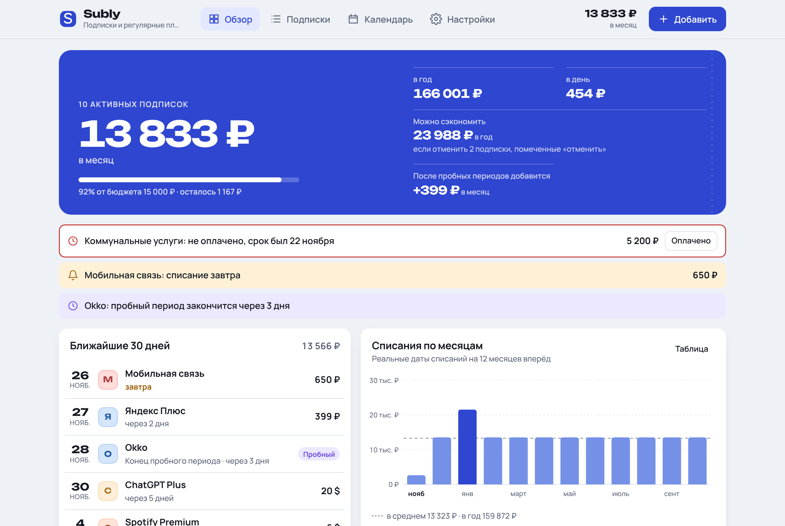
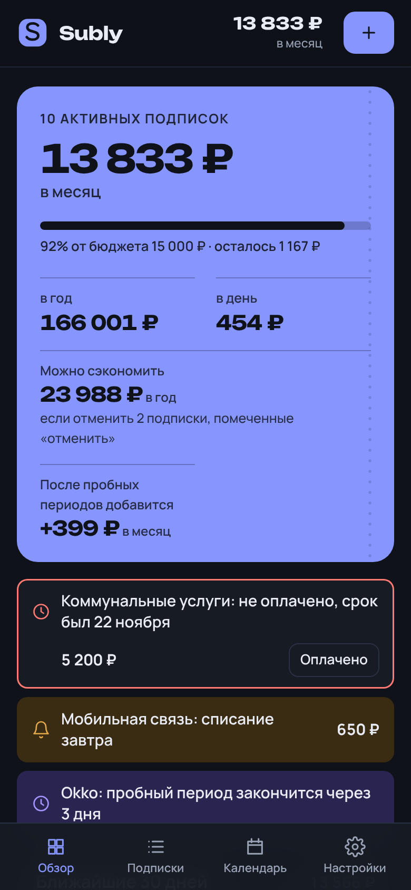
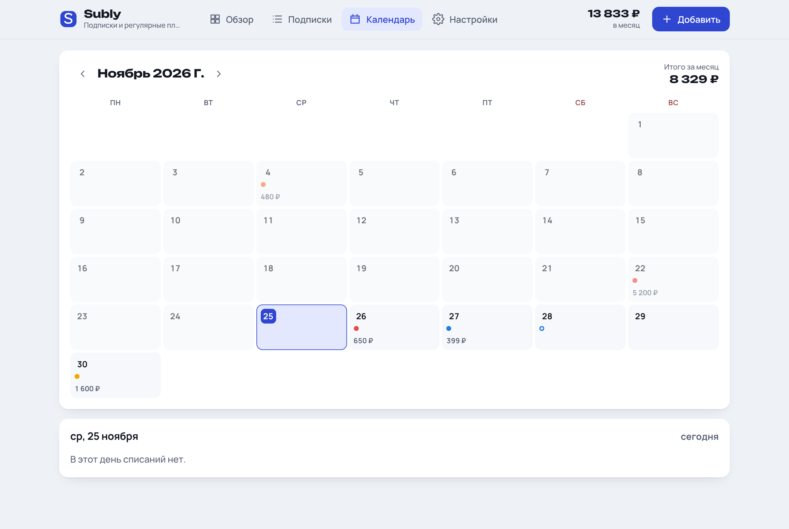

<p align="center">
  
</p>

<h1 align="center">Subly</h1>

<p align="center">
  <b>Подписки и регулярные платежи под контролем.</b><br>
  Без регистрации, без привязки банка, без сервера. Работает офлайн.
</p>

<p align="center">
  <a href="https://howknowme.github.io/subly/"><b>Открыть приложение →</b></a>
</p>

<p align="center">
  
</p>

## Зачем это

Netflix за 15 $, Яндекс Плюс, облако, мобильная связь, спортзал, ChatGPT… По отдельности это мелочи, но вместе набегают десятки тысяч рублей в год. А пробные периоды тихо превращаются в платные.

Subly показывает **реальную сумму**, предупреждает **до списания** и подсказывает, **что можно отменить**.

Другие трекеры часто требуют аккаунт, доступ к банку или сами продаются по подписке. Subly хранит всё только в вашем браузере и ничего никуда не отправляет.

## Возможности

| | |
|---|---|
| 💰 **Сводка расходов** | В месяц, в год и в день, с пересчётом всех валют в основную |
| 🎯 **Бюджет** | Лимит в месяц, процент использования и предупреждение о превышении |
| ✂️ **«Можно сэкономить»** | Отметьте подписки, которые хотите отменить, и увидите экономию за год |
| 🧪 **Пробные периоды** | Не входят в расходы, пока не закончатся; напоминание за день |
| 👨‍👩‍👧 **Семейные тарифы** | «Делю с N людьми»: в расходы попадает только ваша доля |
| 🧾 **Ручные платежи** | ЖКХ, аренда, кредит: кнопка «Оплачено», видны неоплаченные и просроченные |
| 📅 **Календарь** | Месяц со всеми списаниями и суммами по дням |
| 📈 **Прогноз на 12 месяцев** | Реальные даты списаний: видно «тяжёлые» месяцы с годовыми оплатами |
| 🗂 **Категории** | Куда уходят деньги: кино, музыка, облака, работа, игры, связь… |
| 🕰 **История и «за всё время»** | Сколько уже заплачено каждому сервису |
| 🔔 **Напоминания** | Уведомления браузера и экспорт в Google, Apple или Outlook Календарь (`.ics`) |
| ⚡ **Быстрый выбор** | Около 30 популярных сервисов в один клик |
| 💾 **Резервная копия** | JSON (файл или буфер обмена), восстановление, CSV для Excel |
| 🌗 **Удобство** | Тёмная тема, русский и английский, горячие клавиши, установка на телефон |

Списания по любому графику: каждые N дней, недель, месяцев или лет. Если подписка оформлена 31-го, в коротких месяцах дата корректно переносится на последний день.

<p align="center">
  
  &nbsp;
  
  &nbsp;
  
</p>

<p align="center">
  
</p>

## Приватность

- Нет регистрации и аккаунтов.
- Нет доступа к банку, почте и SMS.
- Данные хранятся только в `localStorage` вашего браузера.
- Интернет нужен только для кнопки «Обновить курсы» (open.er-api.com), и ей можно не пользоваться.
- Нет аналитики, трекеров и рекламы.

Чтобы перенести данные на другое устройство: **Настройки → Скачать копию**, затем **Загрузить из файла** на новом устройстве.

## Установка на телефон

Откройте [howknowme.github.io/subly](https://howknowme.github.io/subly/):
- **iPhone (Safari):** «Поделиться» → «На экран „Домой“».
- **Android (Chrome):** меню ⋮ → «Установить приложение».

После этого Subly открывается как обычное приложение и работает без интернета.

## Для разработчиков

Чистые HTML, CSS и JavaScript-модули: без фреймворков, без сборки, без зависимостей.

```bash
git clone https://github.com/howknowme/subly
cd subly
npm start          # http://localhost:8080
npm test           # юнит-тесты логики (node:test)
npm run test:e2e   # сквозной тест в Chromium (нужен Playwright)
```

```
index.html                  оболочка приложения
css/app.css                 стили, светлая и тёмная темы
js/core.js                  чистая логика: даты, циклы, валюты, прогноз, .ics, CSV, валидация
js/i18n.js                  тексты RU/EN, категории, шаблоны сервисов
js/app.js                   интерфейс, хранение, напоминания, PWA
sw.js                       офлайн-кэш
scripts/build-artifact.mjs  сборка в один HTML-файл
```

Сайт выкладывается на GitHub Pages автоматически при пуше в `main` (`.github/workflows/pages.yml`).

## Лицензия

[MIT](LICENSE): пользуйтесь, меняйте, делитесь.
